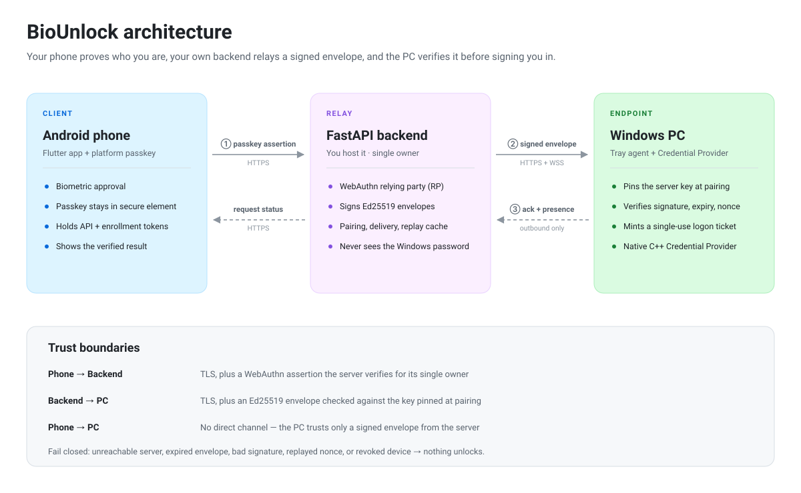
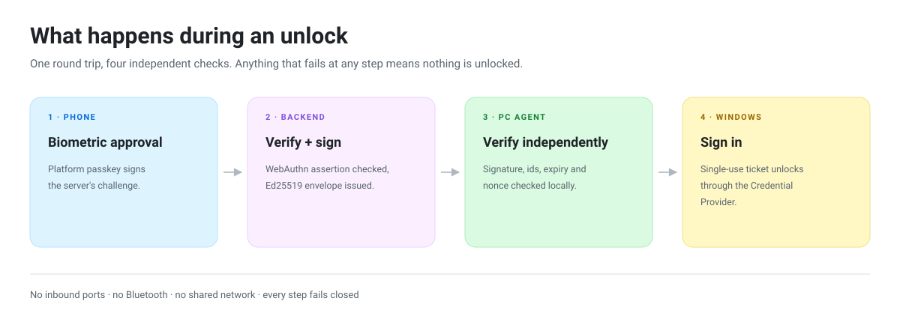

# BioUnlock Architecture

This document describes the components, trust boundaries, and data flow of
BioUnlock. Read it together with `protocol.md`.

## Goal

Allow a user to prove who they are with a phone (WebAuthn passkey) and have a
paired Windows PC verify an authorization request, over the public Internet,
without inbound ports or shared Wi-Fi/Bluetooth.

## Components

The phone and the PC agent make only outbound connections; nothing listens on
the PC for inbound traffic.

- **Phone**: authenticates the human via the platform passkey provider
  (biometric-backed WebAuthn). The server is the WebAuthn Relying Party (RP).
- **Backend**: authorizes the user, resolves the target PC, creates
  cryptographically signed authorization envelopes, and delivers them to the
  PC agent. It never knows the Windows password and never unlocks Windows.
- **PC agent**: owns its device identity, keeps the server's signing key
  pinned, verifies every request independently, and reports a truthful result.

## Trust boundaries

| Boundary | Trust mechanism |
| --- | --- |
| Phone → Server | TLS + WebAuthn passkey assertion verified by the server |
| Server → Phone | TLS; server authenticity is a trust-on-first-use decision by the user when they enter the URL / scan a pairing QR |
| PC Agent → Server | TLS + short-lived device Ed25519 signature on authenticated calls |
| Server → PC Agent | Ed25519 signature over each authorization envelope, verified against a pinned server public key captured during pairing |
| Phone → PC Agent | No direct channel; the agent only trusts a signed envelope from the server that binds the single owner, PC, request id, and expiry |

The **server signing key** is the root of truth for the PC agent. It is pinned
exactly once during the enrollment/pairing flow, together with the backend URL.
Changing the backend URL breaks the pinned server identity and forces a new
pairing — the PC agent will not accept requests from a server it did not pair
with.

## Data flow: remote authentication request

1. **Phone** (authenticated, WebAuthn user) requests a challenge for a target
   PC: `POST /api/v1/auth/challenges`.
2. **Server** stores a challenge (random bytes, expiry, client data) and returns
   it bound to the target PC.
3. **Phone** prompts the user with the platform passkey provider, then submits
   the assertion: `POST /api/v1/auth/requests`.
4. **Server** verifies the WebAuthn assertion for its single owner, confirms
   the target PC is active, creates an `AuthRequest` (unique id, PC, challenge,
   expiry, status=pending), and signs an *authorization envelope* with its
   Ed25519 key. The wire format includes the constant owner id `biounlock`.
5. **Delivery**: if the agent has an open, live outbound WebSocket, the envelope
   is pushed. A socket that has gone silent past the keepalive window is treated
   as dead, so the agent switches to polling the REST inbox and reconnects. On
   reconnect, pending envelopes are pulled. No inbound ports.
6. **PC agent** verifies the envelope signature against the pinned server key,
   checks identifiers (its registered PC id and owner id `biounlock`), expiry, and
   replay/nonce. On a verified `remote_unlock` it mints a short-lived,
   single-use ticket for the native Windows Credential Provider, which performs
   the real unlock; `remote_lock` calls `LockWorkStation()`.
7. **PC agent** acks `POST /api/v1/requests/{id}/ack` → status `verified`
   (or rejects → `rejected`).
8. **Phone** polls `GET /api/v1/requests/{id}` until a terminal status and
   shows a truthful result ("Verified by PC", "Rejected", "Expired").

## Failure handling

- Server unreachable → the phone cannot authorize and the agent cannot
  receive; no request is accepted. Fail closed.
- Envelope expired → rejected.
- Envelope replayed/duplicate → rejected (unique id + nonce cache).
- Device revoked / unpaired → agent rejects; server stops delivery.
- Half-open socket (sleep/resume, Wi-Fi change, NAT timeout) → keepalive pings
  and a silent-socket timeout force a reconnect while the REST inbox covers
  delivery in the meantime.
- Reconnect: the agent re-establishes WebSocket and re-registers presence.

## Key storage

| Secret | Where | Protection |
| --- | --- | --- |
| Passkey private keys | Phone TPM/secure element | platform (never in BioUnlock) |
| Server signing key | Deployment secret store (`BIO_SIGNING_KEY`) | encrypted platform secret storage; required in deployed environments |
| PC device private key | Windows machine | DPAPI-protected file |
| Owner API token | Server environment + phone secure storage | shared long-lived secret; rotate if exposed |
| Enrollment token | Server environment + phone secure storage | second shared secret; required to change passkeys once one exists |